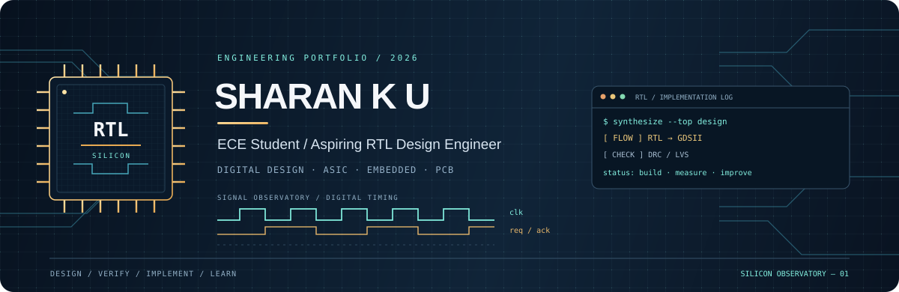

# Sharan K U — Silicon Observatory



**Sharan K U**  
BMS Institute of Technology and Management  
**RTL Design and Semiconductor Engineering**  
Design. Verify. Implement. Learn.

---

## Identity and positioning

I am an Electronics and Communication Engineering student at **BMS Institute of Technology and Management**, focusing on RTL design, verification, and ASIC implementation. This profile emphasizes reproducible flows, clear design intent, and evidence-backed projects.

---

## Engineering philosophy

Small, verifiable increments: clear interfaces, testbenches that exercise corner cases, and flows that can be reproduced on Ubuntu/WSL.

**SystemVerilog mindset (example):**
```systemverilog
// Interface-first style (illustrative)
interface uart_if(input logic clk, input logic rst_n);
  logic tx_ready, rx_valid;
  logic [7:0] tx_data, rx_data;
endinterface
```

---

## Selected engineering work

| Project | Purpose | Contribution | Tech | Link |
|---|---:|---|---|---|
| **8-bit ALU ASIC Design** | RTL ALU design and ASIC-ready layout | RTL, testbench, synthesis scripts | SystemVerilog; Yosys; OpenLane | [Repo](https://github.com/Sharan21-cmd/8-bit-ALU-ASIC-Design) |
| **FSM-Based 4-Way Traffic Light Controller ASIC** | Finite-state control with timing constraints | RTL, assertions, gate-level sim | SystemVerilog; iverilog | [Repo](https://github.com/Sharan21-cmd/FSM-Based-4-Way-Traffic-Light-Controller-ASIC) |
| **UART Transmitter and Receiver** | UART transmitter/receiver RTL and verification | RTL, testbench, integration notes | SystemVerilog; simulation | [Repos](https://github.com/Sharan21-cmd?tab=repositories) |
| **STM32H743I-EVAL2 8-Layer PCB Design** | 8-layer evaluation board layout and DRC | Schematic, layer stack, DRC reports | Altium Designer; Gerbers | [Repo](https://github.com/Sharan21-cmd/STM32H743I-EVAL2-8-Layer-PCB-Design) |

---

## Technical capabilities

**RTL and digital design**
- SystemVerilog, testbench-first approach.
- Synthesis with Yosys; gate-level simulation.

**ASIC implementation and physical verification**
- OpenLane exposure; SKY130 flow familiarity.
- Timing-aware design and constraint-driven verification.

**PCB design**
- Multilayer routing, DRC, Altium workflows.

**Programming and embedded systems**
- Python for automation; C for embedded firmware.

**Development tools and Linux**
- Ubuntu/WSL workflows, Git, Make, shell scripting.

---

## Current engineering direction

Planned next steps:
- Expand RTL verification coverage with constrained-random tests.
- Integrate timing-aware assertions and static timing checks.
- Produce a small ASIC flow demo using OpenLane + SKY130 on a toy design.

---

## Visual system

Assets included:
- `assets/banner.svg` — hero banner (SVG).
- `assets/architecture.svg` — compact RTL-to-ASIC workflow.
- `assets/legend.svg` — color legend and tokens.

All assets are vector SVGs authored for GitHub Markdown compatibility.

---

## Local build and validation

### Prerequisites
- Ubuntu/WSL recommended.
- Optional: `xmllint` (libxml2-utils) for SVG validation.

### Validate
Run:
```bash
# from the project root
./setup.sh --validate
```

This will check that required files exist and optionally run xmllint if available.

---

## Contact and closing identity

I build hardware-focused digital systems with a verification-first mindset.  
**GitHub:** https://github.com/Sharan21-cmd

README generated by a single-file profile generator. Edit the top of `setup.sh` to customize identity, colors, and project links.
